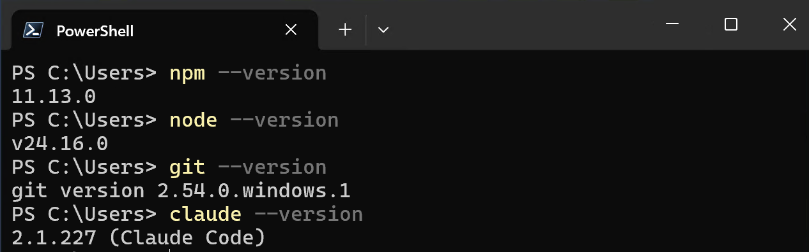

# Getting Started — Claude Code CLI & the SAPUI5 plugin (10 min)

[Back to Overview](../../README.md) | [Next: Exercise 1 — Create & enhance a JS app →](../ex1/README.md)

In this exercise you set up **Claude Code CLI** with the **UI5 plugin for coding agents** and
confirm that the agent is *grounded* — that it can pull real answers from the official SAPUI5 API
reference through the UI5 MCP server. Everything in the rest of the workshop builds on this.

> [!NOTE]
> On the workshop machines, Claude Code is already installed and configured with an Anthropic API
> key. If you are following along on your own machine, you'll need your own Anthropic account.

## 0.1 Verify the prerequisites

Open a terminal in the workshop repo and check the toolchain:

```bash
npm --version 
node --version   # v22 or newer
git --version
claude --version
```




## 0.3 Install the UI5 plugin

The UI5 plugin bundles the **UI5 MCP server** (API reference, linter, app scaffolding) and the UI5
best-practice skills:

```bash
claude plugin install ui5@claude-plugins-official
```

> [!NOTE]
> In some rare cases the marketplace pre-installed on the workshop machines may not be up to date,
> so the UI5 plugin cannot be found. If that happens, refresh the marketplace manually first:
> ```bash
> claude plugin marketplace update claude-plugins-official
> ```
> Then re-run the install command above.

## 0.4 Launch Claude Code in the repo

From the repository root:

```bash
claude
```

> [!TIP]
> 💡 **Task:** Confirm the UI5 MCP server tools are available. Ask Claude Code:
> ```
> Which UI5 MCP server tools do you have available?
> ```
> You should see tools such as `get_guidelines`, `get_api_reference`, `run_ui5_linter`,
> `create_ui5_app` and many more.

> [!NOTE]
> If you restarted `claude` but the tools are still not listed, the MCP server process may have
> failed to start. Type `/plugins`, search for **ui5**, and click **Reconnect**. See
> [FAQ — MCP server not available after install](../../FAQ.md#the-plugin-is-installed-and-claude-has-been-restarted-but-the-ui5-mcp-server-tools-are-still-not-available)
> for the full recovery steps.

## 0.5 Hello, grounded agent

Now confirm grounding works end-to-end:

> [!TIP]
> 💡 **Task:** Ask Claude Code:
> ```
> What's the latest version of SAPUI5?
> ```
>
> Watch it call the `get_version_info` tool to look up the latest SAPUI5 release.

## Verify

- [ ] `claude` launches in the repo without errors.
- [ ] The UI5 MCP server tools are listed when you ask.
- [ ] Claude Code returns UI5 expertise offered by the **UI5 MCP server**.

## Summary

You now have a grounded UI5 coding agent. In Exercise 1 you'll put it to work scaffolding and
enhancing a real SAPUI5 application.

---

[Back to Overview](../../README.md) | [Next: Exercise 1 — Create & enhance a JS app →](../ex1/README.md)
