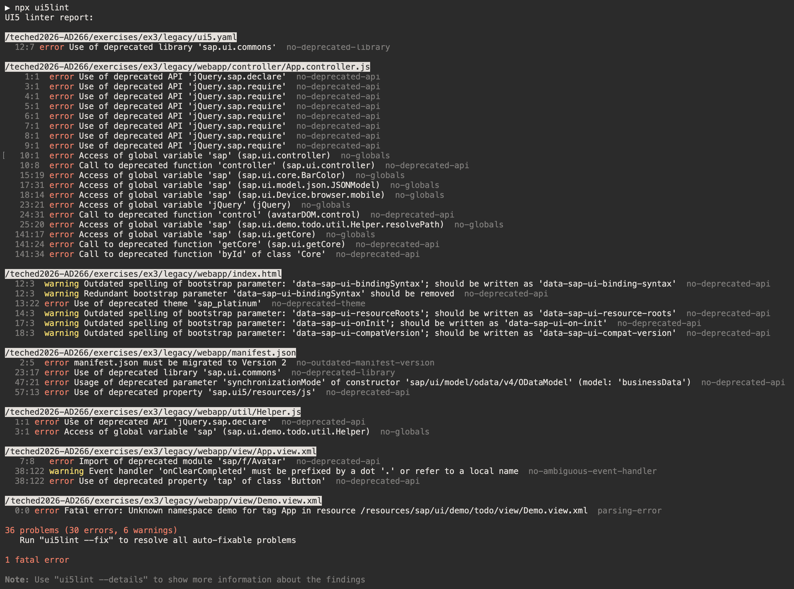

# Exercise 3 — Modernize a legacy SAPUI5 project (40 min)

[← Previous: Exercise 2 — Convert to TypeScript](../ex2/README.md) | [Back to Overview](../../README.md) | [Next: Exercise 4 — Create a custom control in TypeScript (optional) →](../ex4/README.md)

In this exercise you run the **UI5 Modernization** workflow on a deliberately legacy app. The
workflow is a structured, five-phase process: it detects issues with the UI5 linter, delegates
fixes to specialized skills, commits each phase separately, and re-runs the linter as a verification
gate before moving on.

The legacy app is a to-do app (based on
[`flovogt/openui5-sample-app`](https://github.com/flovogt/openui5-sample-app)) seeded with
intentional anti-patterns.

> [!NOTE]
> This app is a **curated** "before" state. Some parts are deliberately legacy (see 3.2); others
> are already modern and serve as a reference. In particular, its test infrastructure already uses
> the Test Starter concept and its `index.html` bootstrap is already CSP-compliant — so **Phase 1
> has little to do and Phase 5 finds nothing to fix here**. That's expected; the value is seeing
> the workflow correctly detect "already clean" as well as fix real issues.

## 3.1 Set up the legacy app

Download the legacy app [legacy.zip](https://github.com/SAP-samples/teched2026-AD266/raw/main/exercises/ex3/apps/legacy.zip). Save the zip into your existing `apps` folder on the Desktop (the same one you used in Exercise 1). Then open a **new terminal** and run:

```bash
cd ~/Desktop/apps
tar -xf legacy.zip
cd legacy
npm install
```

The modernization workflow makes **one git commit per phase**, so initialize a dedicated git repo here so the per-phase commits land in their own timeline.

First, create a `.gitignore` file in the `legacy/` folder with the following content:

```
node_modules/
```

Then initialize the repo:

```bash
git init && git add -A && git commit -m "baseline: legacy app"
```

Open the `legacy/` folder in Claude Code (e.g. `claude ~/Desktop/apps/legacy`) — all subsequent tasks in this exercise run from that folder.

## 3.2 Install the plugin and take a baseline linter reading

```bash
claude plugin install ui5-modernization@claude-plugins-official
```

> [!TIP]
> 💡 **Task:** Ask Claude Code:
> ```
> Run the UI5 linter on this app and report the UI5 linter findings.
> ```
>

The baseline for this app is **36 problems (30 errors, 6 warnings) and 1 fatal error** — the
findings map directly to the modernization phases:



You should see findings that map to the modernization phases. A tour of what's intentionally wrong:

| Phase | Anti-pattern in this app | Where |
|-------|--------------------------|-------|
| 2 — Foundation | `"_version": "1.76.0"`; `rootView` and the i18n model carry inline `async` flags (removed in manifest v2) | `webapp/manifest.json` |
| 2 — Foundation | `Component.js` does not implement `sap.ui.core.IAsyncContentCreation` | `webapp/Component.js` |
| 3 — Globals | `jQuery.sap.declare`/`jQuery.sap.require`, `sap.ui.controller(...)` factory, `sap.ui.getCore()`, `sap.ui.core.BarColor`, global `Filter`/`FilterOperator`, app-namespace `Helper` global | `webapp/controller/App.controller.js` |
| 3 — Globals | assigns to the `sap.ui.demo.todo.util.Helper` global instead of returning a module | `webapp/util/Helper.js` |
| 3 — XML globals | `tap="onClearCompleted"` (deprecated event + ambiguous handler, no `.` prefix); undeclared `demo:` namespace | `webapp/view/App.view.xml`, `Demo.view.xml` |
| 4 — Deprecated APIs | dependency on the removed `sap.ui.commons` library; `synchronizationMode` on the OData V4 model | `webapp/manifest.json` |
| 4 — Deprecated APIs | deprecated bootstrap params (`compatVersion=edge`, `bindingSyntax=complex`, experimental `xx-wait-for-theme`) and the deprecated `sap_platinum` theme | `webapp/index.html` |

> [!NOTE]
> Optionally set up the **Chrome DevTools MCP server** for automated browser-based test
> verification during the workflow, or use manual verification mode.

## 3.3 Run the full modernization workflow

> [!TIP]
> 💡 **Task:** Kick off the orchestrator skill:
> ```
> /ui5-modernization:modernize-ui5-app
> ```
> Pick a verification mode when prompted (full autonomous / half autonomous / manual). The workflow
> applies that mode at every gate.

The five phases and the skills each delegates to:

| Phase | What it does | Key skills |
|-------|--------------|-----------|
| 1. Mechanical baseline | Restructure test infrastructure to the Test Starter concept | `/modernize-test-starter` |
| 2. Foundation | `manifest.json` (version, framework, libraries) + `Component.js` async config | `/fix-manifest-json`, `/fix-component-async` |
| 3. Module system & globals | Remove global namespace access, XML view globals, pseudo-modules, cyclic deps | `/fix-js-globals`, `/fix-xml-globals`, `/fix-pseudo-modules`, `/fix-cyclic-deps`, `/fix-linter-blind-spots` |
| 4. Deprecated APIs | Replace deprecated controls, bootstrap params, renderers, table row modes | `/fix-deprecated-controls`, `/fix-bootstrap-params`, `/fix-control-renderer`, `/fix-partially-deprecated-apis`, `/fix-table-row-mode`, `/fix-xml-native-html` |
| 5. CSP compliance | Extract unsafe inline scripts to external files | `/fix-csp-compliance` |

After each phase the linter re-runs to confirm the phase's findings are resolved before the next
phase starts.

## 3.4 Review the results

> [!TIP]
> 💡 **Task:** Inspect what the workflow produced:
> - `MODERNIZATION-REPORT.md` — statistics and a summary of what changed.
> - `MODERNIZATION-ISSUES.md` — anything that needs manual intervention.
> - `git log --oneline` — the per-phase commits.
> - Walk one or two phase diffs, e.g. `git diff HEAD~2..HEAD~1`, to see exactly what a targeted
>   skill changed.

## 3.5 (Optional) Targeted skill deep-dive

If time allows, revert a single phase and re-run just one skill to see how it works independently
of the orchestrator:

```bash
git revert --no-edit HEAD   # revert the last phase's commit
```

> [!TIP]
> 💡 **Task:** Re-run one targeted skill on its own, e.g.:
> ```
> /ui5-modernization:fix-js-globals
> ```
> or `/ui5-modernization:fix-deprecated-controls`.

## Discussion

- Why phased, per-commit modernization? You can review, revert, or cherry-pick any phase.
- The linter is **both** the detection engine and the verification gate.
- The orchestrator delegates to specialized skills, but a developer can invoke any skill
  individually for a surgical fix.

## Verify

- [ ] UI5 linter is clean, or the residual items are documented in `MODERNIZATION-ISSUES.md`.
- [ ] The app still runs.
- [ ] The tests pass.
- [ ] `git log --oneline` shows the phase commits (fewer than five if a phase found nothing to fix,
      which is expected for this curated app — see the note in 3.2).

## Summary

You modernized a legacy SAPUI5 application with a linter-driven, phased, verifiable workflow — and saw the
agent correctly leave already-modern code alone. Exercise 4 (optional) will take a modern app
one step further by implementing a custom control.

---

[← Previous: Exercise 2 — Convert to TypeScript](../ex2/README.md) | [Back to Overview](../../README.md) | [Next: Exercise 4 — Create a custom control in TypeScript (optional) →](../ex4/README.md)
